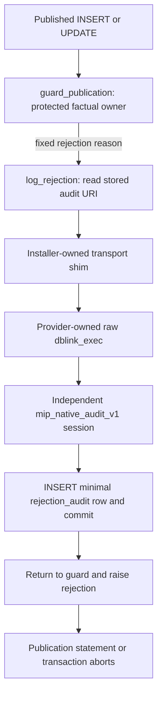

# Qik external libpq and server dblink property trace

Attributed author: delegated agent `/root/qik_property_trace`, 2026-10-07. Read-only source trace; no database connection, credential handoff, network probe, grant, rehearsal, source modification or Cursor dispatch was performed. The sole written artifact is this document. No tests were run because the assignment is architectural inspection and the retained packages must remain unchanged.

**Latest result after recovered historical source:** dblink supplies a required autonomous rejection-audit transaction, synchronously called by a database publication trigger before publication is aborted. Removing only the rehearsal probe leaves that operational dependency untouched. Same-transaction outboxes lose aborted-attempt records; client-only auditing loses trigger coverage of admitted direct SQL callers. A supported trusted alternative preserving all these properties has not been established, so A/B remain unproved and no global C is claimed. Addenda 1–2 contain the recovered exact source, complete call/privilege mapping and a proposed non-executed catalog preflight. Historical-source/current-live correspondence and provider-supported channel/logging facts remain missing.

## Result and evidentiary boundary

The original operation is maintenance of a credential-bearing **server-consumed audit route**, not merely an external client's ability to connect to a database. The frozen operation constructs a server-local CA URI and executes `mip_factual_transport_raw.dblink(new_uri, identity/TLS SELECT)` before storing that URI. Consequently external libpq `verify-full` using a downloaded CA proves a different connection. It cannot, by itself, qualify the PostgreSQL process's CA readability, server-originated connection, auditor credentials as used by that process, or subsequent consumption of the stored route. The server probe has useful route-specific meaning beyond another trust vantage. It is also a hard requirement of the exact immutable source.

The current probe does **not** run an application audit consumer. It runs only `current_user` and the remote backend's `pg_stat_ssl.ssl`; it neither tests audit INSERT/SELECT privileges nor proves audit durability, fail-closed behavior, commit visibility or any runtime audit writer. It uses the local `new_uri` variable before the row UPDATE, so it is not an independent reread of the transformed stored row. Exact local row comparison later bridges candidate URI to the uncommitted stored bytes. Later consumer behavior remains a separate obligation.

The integrated checkout and preserved original package contain no operational installer/runtime SQL defining the consumers of `audit_connection`. All available direct references are enumerated below. A workspace SQL search found only duplicated qualification/maintenance/fixture sources, not the original audit-writing routine. Historical commit `948f83d050ec6b15badd9aa96d867e2840e54840` is referenced in documentation but unavailable as a local git object. Therefore this trace cannot certify that every later consumer can be externalized. Missing consumer evidence must not be converted into a claim that dblink is redundant or that an audit functionality requirement is absent.

Classification definitions supplied by parent: **A** eliminates dblink with every required property preserved; **B** retains dblink only for a non-trust purpose while another supported boundary provides trust; **C** identifies a required property that cannot be satisfied on hosted Supabase. At this checkpoint **neither A nor B is proved; global C is not proved**. The exact frozen operation is unqualified under the provider's October 7 answer. A supported redesign still requires the property and consumer mapping in this document to be closed.

## Source integrity

Observed clean integrated checkout `/workspace/mip-qik-private-client-integration`:

- HEAD `a9ce6b29f46cc965fd45c9edefcb7428f3493c69`.
- Tree `a44cabcecfb55b0f9da0921e6c7538ff3c640c64`.
- `git status --short` produced no entries.

Read-only byte comparisons with `/workspace/mip-original-qik-rollback-package` returned equality for each of:

| Preserved file | Bytes | SHA256 |
|---|---:|---|
| `scripts/qualification/qik-audit-route-transform-proposal-20261002.sql` | 7101 | `5be14204dbd68b44ccaba07222bd6a5b4f9d9f627ce4750fce596211e6d6fb46` |
| `scripts/qualification/qik-audit-route-pre-submit-deadlines-20261002.sql` | 324 | `2ac3ca583a82fc717cca12b9f64d40019339b3be7c2aeefb0948473a5336518d` |
| `scripts/qualification/backend-live-rehearsal/source-lock.json` | 3572 | `be46812c3154b58162037d93a755b544e8862d81eb26738369db6887bdf8f18c` |
| `scripts/qualification/backend-live-rehearsal/package.mjs` | 19837 | `0051f2d1b2b219ced57e1590c88a64c2ac18cd2b9a2a26bb39f5394543dc40a4` |
| `scripts/qualification/backend-live-rehearsal/submission-protocol.json` | 9759 | `71eba36030f172fc642d52cf676eb98e8421309f191d0c31b9848e362b6e1e94` |

These hashes cover public source only. No stored URI, secret, secret-derived fingerprint or private source baseline was obtained or hashed.

## Exact evidence index

All paths beginning `scripts/` or `docs/` in the tables below are under `/workspace/mip-qik-private-client-integration/`.

| ID | File and lines | What it establishes |
|---|---|---|
| E1 | `scripts/qualification/qik-audit-route-transform-proposal-20261002.sql:1–30` | Proposal-only identity, advisory lock and exact installed-disabled manifest/receipt/bootstrap/head/qualification guards. |
| E2 | Same SQL `31–54` | Logging refusal before secret read, duration settings, missing-column authority guard, and server `ssl_ca_file` absolute path derivation. |
| E3 | Same SQL `55–88` | `FOR UPDATE` read of true row; exact source pooler and target direct URI forms; three parameters; unchanged opaque password bytes; replacement of system CA by server CA path. |
| E4 | Same SQL `89–109` | Password-bearing server dblink on candidate URI; only remote current_user/SSL result; fixed exception; CAS update; ROW_COUNT=1; no ordinary returned secret. |
| E5 | `scripts/qualification/backend-rollback-sql/compare-rows-private.sql:1–42` | Private full-row, unrelated-row and opaque credential equality; exact expected transformation, with CA path bound separately. |
| E6 | `scripts/qualification/backend-rollback-sql/capture-rows-private.sql:1–6`; `inspect-rows-public.sql:1–4`; `inspect-rows-private-booleans.sql:1–25` | Actual baseline/count/shape consumers; secret read stays in private memory; installed-state guards. |
| E7 | `scripts/qualification/backend-rollback-sql/snapshot-public.sql:1–29,59–87` | Catalog scope includes auditor/owners/grantors, table/RLS, effective dblink EXECUTE, logging metadata, server CA setting, dblink function flags. |
| E8 | `scripts/qualification/backend-rollback-sql/boundary.mjs:55–96,99–142` | Hard-pinned frozen SQL; private exact role configuration/function definition capture; narrow postgres/owner/FORCE RLS and provider grantor baseline; invoker/strict text,text dblink requirement. |
| E9 | `scripts/qualification/backend-rollback-sql/authority-commands.json:1–10` | Exact SET-only membership and owner-granted column UPDATE, with correct-grantor RESTRICT cleanup. |
| E10 | `scripts/qualification/backend-live-rehearsal/package.mjs:7–73,80–96,168–205` | Exact target and eleven requirements; fixed command inventory; source lock refusal; immutable guarded submission. |
| E11 | `scripts/qualification/backend-live-rehearsal/submission-protocol.json:8–37,39–46` | Logging/evidence before private captures; separately acknowledged deadlines; transformation verification; mandatory ROLLBACK; separate verifier comparisons/completion checks. |
| E12 | `scripts/qualification/backend-private-client/libpq17.py:163–206,421–465` | Explicit external fields and local CA; verify-full; password authentication; client cert disabled; no implicit PG env; one connection; TLS/version/protocol/target/idle checks. |
| E13 | Same Python `300–337,360–366,611–650,668–686` | Frozen primary/verifier command inventories; native source is not authority; final-result drain; encrypted libpq17 cancel API. |
| E14 | `scripts/qualification/backend-private-host/controller.mjs:68–88,102–133,181–201,205–277` | Verifier is separate postgres connection matching primary target; private baseline/CA bindings; no operation replay; one rollback; independent checks; missing ACK stays UNKNOWN. |
| E15 | `scripts/qualification/backend-private-host/bridge.mjs:12–32,38–50,72–107,111–119,148–159` | Runtime remains false; accepted authority before spawn/handoff; handoff unbound; two separate primary/verifier workers; supplied approved server CA path is separate from connection fields. |
| E16 | `scripts/qualification/backend-private-authority/contract.mjs:1–30`; `production.mjs:6–32`; `trust-registry.json:1` | Eleven binding names, fixed original guarded hash/target, rollback-only phases; exact empty registry refuses production. |
| E17 | `docs/qualification/qik-original-rollback-approval-20261002.md:9–21,25–46` | Preserved source, one true row/column, exact narrow authority/no policy/RLS changes, independent postgres verifier, later COMMIT separate. |
| E18 | `docs/qualification/qik-rollback-sql-boundary-20261002.md:7–21,27–31` | Public/private baseline distinction; fixed admitted privilege branch; exact NULL ACL restoration; historical metadata is partial, synthetic engines do not qualify provider. |
| E19 | `docs/qualification/qik-private-libpq-source-20261003.md:9–25,27–29` | External local trust/CA/profile and transport purpose/limits; fake-libpq tests not TLS or provider qualification. |
| E20 | `docs/qualification/qik-private-host-source-20261003.md:46–107,109–149` | Recovery semantics, verifier independence, unobserved SQL identity/server read-only at connection, authority/runtime/handoff absent. |
| E21 | `/workspace/mip-launch-receipts/MIP Exact Qik Rollback Rehearsal Scope 2026-10-03.md:31–59,76–89,142–158` | Rehearsal tests candidate dblink identity/TLS only; no application audit write; row uncommitted; rollback cannot erase external logs; later audit-route COMMIT a separately gated stage. |

Provider premise supplied by parent for this task, not freshly fetched by this agent: October 7 final response supports external libpq verify-full with the downloaded CA, offers no supported stable server trustfile/system-store interface, cannot confirm server dblink verify-full to the endpoint, identifies password authentication rather than sslcert, and leaves the requested logging matrix unknown. Durable parent citation should accompany those provider claims; no new provider state was observed in this trace.

## Connections and their purposes

| Lane | Actor, code and evidence | Purpose | Distinction |
|---|---|---|---|
| External primary | Private host/Python libpq17, intended authenticated postgres (E12/E14/E15). | Admit protected external TLS, observe private baselines, execute precise temporary authority and guarded maintenance, track command acknowledgments and restore/rollback. | Uses explicit **executor-local** `sslrootcert`. External downloaded CA support concerns this lane. It does not consume the stored audit URI to connect as the auditor. |
| Server auditor dblink | PostgreSQL extension function executed by local postgres; remote `mip_native_audit_v1`; E3/E4/E7/E8. | Exercise the candidate **server-side audit route** with its exact password, direct hostname, three parameters and **server-local** CA path; require distinct auditor/current_user and SSL before local update. | Independent remote backend/session. Different trustfile filesystem, network origin, client library/default environment and SQL role from primary. This lane is not the post-rollback verifier. |
| External independent verifier | Separate worker/socket, intended postgres; E11/E13/E14/E15. | After rollback, independently compare captured row/security data, observe primary backend transaction/advisory-lock completion and refuse missing ACK. | Same authenticated SQL account as primary; distinct connection/control queue, not auditor privilege isolation. Client inventory is read-only; SQL server transaction-read-only is unobserved. |
| Cancellation control | New libpq17 cancellation connection, E13/E19. | Bound uncertainty by encrypted cancellation dispatch and original-command drain. | Cancellation dispatch is not the original command outcome; no replay permission. Not an audit consumer or TLS substitute for dblink. |

Two external postgres sessions plus the server-originated distinct auditor session can connect to the same database endpoint while proving different things. Endpoint equality does not collapse connection origin, filesystem, authentication identity, trust verification or transaction context.

## Every current `audit_connection` use found in the bounded package

| Direct consumer | Read/write/transport | Exact scope and significance |
|---|---|---|
| Guarded maintenance DO, E2–E4 | Read selected credential URI; lock true row; construct candidate; dblink **candidate variable**; update selected value. | Sole non-fixture password-bearing dblink invocation found in these sources; sole target-table write. The route becomes persistent only under a later separately authorized COMMIT. |
| `inspect-rows-public.sql`, E6 | Read boolean id counts. | Never reads URI/nullness/secret-derived hash. |
| `inspect-rows-private-booleans.sql`, E6 | Read selected URI shape/nullness; output boolean/counts. | Secret-dependent private observation, not a connection or runtime audit test. |
| `capture-rows-private.sql`, E6 | Read every id and exact URI into private result. | Private baseline for rollback/unrelated rows; result kept outside transaction in executor memory. |
| `compare-rows-private.sql`, E5 | Read every row; privately bind baseline/CA path; compare source/transformed/unrelated/password bytes. | Does not connect with URI. Used before cleanup and after rollback, including distinct verifier. |
| `snapshot-public.sql`, E7 | Read table/catalog/ACL/RLS/publication/role/dblink metadata. | Does not read URI. `ssl_ca_file` is only an observed setting/path, not proof of file bytes, trust appropriateness or readability. |
| Private security capture/comparison, E8 | Read role configuration and dblink bodies/configuration, plus public catalog baseline. | May itself contain secrets; protects immutability/restoration, not route success. |
| `authority-commands.json`/operation-context observation, E9/E11 | Grant/revoke UPDATE(connection_string), inspect existing SELECT/UPDATE privileges. | Capability is column-wide; immutable command bounds selection to true row. No new SELECT/table UPDATE/security change. |
| Target/manifest/contracts, E10/E16 | Static data containing table/predicate/column name. | Source/evidence bindings, not executed consumers. |
| Synthetic bootstrap/test/qualification copies | Dummy URI/dblink stub and fixture writes. | Excluded as operational consumers; they prove only stated synthetic semantics. |

No application source under `src/`, `services/`, `supabase/` or non-qualification `scripts/` in the integrated checkout referenced `audit_connection` or `mip_factual_transport_raw.dblink`. The same operational-consumer absence was found in `/workspace/mip-original-qik-rollback-package` and `/workspace/mip-original-backend-source-readonly`. This is a **source availability finding**, not a live catalog finding and not proof that installed routines do not exist. Parent is obtaining previously read durable installer/catalog evidence separately.

## Property mapping

Labels: required = property of the fixed operation/goal; useful = meaningful evidence beyond necessity; redundant = observation duplicates another observation for the same limited fact; unsupported = no currently established provider-supported route to the fact; replaceable = a qualified successor may preserve the property by a different mechanism. These labels can coexist: required/unsupported does not mean mathematically impossible.

| Property | External libpq contribution | Server dblink contribution | Classification and consequence |
|---|---|---|---|
| Exact qik/database/installed-disabled operation/one boolean row/one column | External handoff and source binding plus primary SQL identity/manifest checks. | Uses exact direct qik hostname in candidate URI. | **Required**. Host/address metadata alone cannot supply installed operation identity. Replacement must retain actual manifest/state/row guards. E1/E3/E10/E14. |
| TLS encryption and authenticating primary/verifier endpoint | Explicit local CA and verify-full; success requires TLS/protocol/target checks. | Does not authenticate primary/verifier. | **Required; externally supported class, actual runtime unqualified**. Downloaded CA metadata alone is not a handshake or deployment qualification. E12/E19/provider premise. |
| Trust on server-originated auditor connection | External certificate success can provide useful endpoint/certificate evidence, but uses a different client and trust boundary. | Exact candidate URI requires verify-full; the remote SSL boolean only confirms TLS in use, while appropriate CA and hostname validation must already be established. | **Required in fixed source; useful route-specific evidence; currently unsupported/unqualified**. External-only success does not replace verification of this channel. E2–E4/provider premise. |
| Server trustfile bytes, digest, readability and appropriate trust role | Local CA bytes/readability apply only to external process. | Candidate CA path derives from server `ssl_ca_file`; dblink would read it through server-side libpq. | **Required in original architecture; unsupported as a stable provider interface**. A server TLS setting name is not proof of a supported outbound client trustfile. E2/E7/E16. |
| Same stored auditor credential remains valid after username/endpoint rewrite | Primary can preserve/compare bytes; a newly reviewed external auditor session could test authentication with those bytes. Existing primary/verifier accounts are postgres. | Candidate probe actually authenticates as `mip_native_audit_v1` using preserved password bytes. | **Required; externally replaceable for credential validity only**, but server environment and actual consumer still need proof. Credentials cannot be invented/extracted by this trace. E3–E5/E14. |
| Distinct auditor privilege identity | Primary/verifier provide independent observations, both postgres. | Remote current_user must equal `mip_native_audit_v1`. | **Required**. Distinct recovery connection is not a distinct auditor. Probe does not verify the auditor's audit write/read ACLs, memberships or runtime authorization. E4/E14. |
| Server egress/DNS/extension/libpq environment executes this route | External sessions demonstrate external reachability only. | Candidate connection exercises PostgreSQL process's own origin, environment and endpoint. | **Useful and functionally required if actual runtime consumers remain server dblink**. It is not an extra trust vantage that can simply be dropped. E3/E4. |
| Opaque password preservation, exact URI parameters/order | Primary comparator verifies full expected rows and password bytes. | Successful auditor authentication indirectly corroborates validity but cannot prove byte-for-byte preservation by itself. | **Required; comparator is decisive; authentication useful partly redundant for byte preservation**. Preserve both semantics in successor. E3–E5. |
| Candidate URI equals the stored transformed value | Primary local comparator sees uncommitted full row after DO and derives exact expected bytes. | Probe uses candidate variable **before** UPDATE. | **Required; dblink alone insufficient**, CAS/ROW_COUNT/private comparison cover storage. It is false to call this probe a post-update stored-route read. E4/E5/E11. |
| Runtime consumer obtains committed transformed route and uses it correctly | No current external consumer tests this. | No current dblink payload invokes a consumer or rereads connection table. | **Required before later audit-route operational success; unproved**. Need actual consumer definitions and independently scoped post-COMMIT tests. E21. |
| Audit writes survive local application transaction failure/rollback, if required | A dedicated external auditor connection could commit independently, if complete event delivery and database-only callers are covered. | Standard independent dblink session can enable autonomous audit persistence; current SELECT does not demonstrate it. | **Potential required non-trust purpose; consumer evidence missing**. Do not discard this capability or invent its exact implemented semantics. |
| Audit fail-closed, completeness, causal order, idempotency and no secret payload | External worker may implement some with synchronous protocol but cannot be assumed to intercept every SQL caller. | Current probe proves none of these; installed trigger/functions may provide them. | **Potential required properties; consumer evidence missing**. A replacement must map exact call sites, boundaries and failure behavior. |
| Least authority, FORCE RLS, provider membership/grantor fidelity | Primary adds only exact named transactional capability, observes baseline/security and rolls back; owner grants, postgres performs data operation. | No extra grants; extension must be existing invoker/strict overload executable by postgres. | **Required; mechanism potentially replaceable in successor, not optional**. Provider CREATEROLE/ADMIN shape is a historical narrow feasibility fact, not permission. E8/E9/E17/E18. |
| Private custody and secret-safe errors/logging | Fixed result shapes, private pipe/memory, notices/raw diagnostics suppressed; no secret public receipts/hashes. | URI/password enters extension and remote authentication; fixed caught exception suppresses ordinary returned raw error. | **Required; logging matrix unknown**. Fixed caught exceptions and static GUCs do not prove server/provider DETAIL/context/collector secrecy. Replacing dblink reduces one boundary but does not establish external or database log privacy. E2/E4/E11/E19/E21. |
| Timing, command acknowledgments and uncertainty handling | Nonblocking commands, separate deadline ACKs, native encrypted cancel, drain, one rollback, independent verification; UNKNOWN retained. | URI connect timeout5 and outer statement/lock deadlines; remote/network work is outside local transactional restoration. | **Required; external transport purpose distinct**, cannot be supplied by dblink probe. Real cancellation/native behavior remains unqualified. E11–E15. |
| Exact restoration after ROLLBACK | Same primary settings/security observation plus separate verifier rows/security/backend completion. | Probe's remote authentication/log effects cannot be rolled back by primary. | **Required for local enumerated scope; whole-system erasure unclaimed**. New remote side effects need explicit mapping and privacy evidence. E14/E18/E21. |
| Exact reviewed bytes, eleven inputs, single attempt and no COMMIT | Multiple nested source pins, empty production registry/runtime/handoff remain closed. | Hard-pinned operation mandates its dblink block and CA rewrite. | **Required immutable scope**. Changing/removing either creates a successor needing revised pins/protocol/authority/evidence, independent review and later authorization. E10/E15/E16/E17. |

## Transaction visibility and later COMMIT

1. The primary begins one local transaction, captures private baselines in host memory, temporarily introduces only the precise privileges, and submits two separate deadline commands before the DO. E9/E11/E14.
2. The DO acquires its advisory transaction lock and locks the true row, validates the old pooler URI, derives `new_uri`, then opens the independent server-originated auditor connection. Its remote query reads identity/TLS only. It does not read `audit_connection` at all. E1/E3/E4.
3. The local CAS UPDATE occurs **after** that probe. Successful DO completion establishes ROW_COUNT=1. The same primary can then observe its own uncommitted transformed row; private comparator verifies exact bytes. E4/E5/E11.
4. A separate connection cannot see this primary's uncommitted row rewrite. Merely adding a remote query that rereads the table before COMMIT would ordinarily observe the old committed route; lock-dependent queries could block. Sending the candidate as an argument is different from proving a later routine discovers committed storage. This is standard transaction separation, not a new provider observation.
5. Success-path cleanup restores introduced authority/settings and mandatory ROLLBACK restores local row/catalog state. Distinct external postgres verifier subsequently compares restored rows/security and observes primary completion. It verifies restoration, not the new committed route. Missing rollback ACK remains UNKNOWN even if equality passes. E11/E14.
6. A later COMMIT package is a separate authorization/source/evidence stage. Even the current identity/TLS probe plus a successful future maintenance COMMIT would not demonstrate correct application audit consumer, its privilege behavior, independent audit-write persistence or ongoing trustfile stability. E21.

Local ROLLBACK cannot erase remote login attempts, network/provider/statistics records, or a separately committed audit write if a future consumer performs one. Conversely a same-transaction audit table or outbox generally rolls back with the primary; if rollback-surviving failure auditing is required, it is a semantic change to adopt those alone.

## Supported substitutes considered without changing source

These are architectural assessments, not implementations or permission to test. A supported PostgreSQL feature is not evidence that this hosted provider exposes the necessary runtime interface. Every candidate must maintain password authentication; `sslcert` is a client-certificate mechanism and does not provide a server trust anchor or substitute for `sslrootcert`.

| Alternative | What it really establishes | Uncovered properties / strict scope delta | A/B/C impact |
|---|---|---|---|
| External libpq verify-full with downloaded CA, keeping original server DO | Supported external primary/verifier trust preparation, then original operation if all its separate gates can be met. | Server CA file/outbound trust and dblink error/log matrix remain unknown; no original source delta but no execution qualification. | Useful safe preparation; proves neither A nor B; not global C. |
| External **distinct auditor** verify-full authentication using privately retained exact transformed credential, followed by local guarded CAS/comparison | Could validate candidate credential/endpoint/TLS from external executor, byte preservation and local transformation/restoration. | Current fixed inventory/handoff does not include this connection/probe. Removing DO dblink/CA rewrite changes frozen source, hashes, manifests, comparisons and eleven-input meaning. It cannot validate server CA/egress or leave unchanged runtime dblink consumers qualified. | Possible part of A only after **all** consumers/properties are mapped and migrated. External authentication alone is not A. |
| Keep runtime dblink but replace server trustfile with `sslrootcert=system` or provider-supported stable outbound trust | Potential B with authenticated server-originated TLS if provider documents/qualifies actual stable trust boundary. | Provider does not supply a supported stable server system-store/trustfile interface or confirmed dblink verify-full. Old exact operation rejects system as target and requires direct server-path replacement. | Conditional route requiring evidence and revised source; neither proved B nor failed universally. |
| Keep dblink to same qik via direct/pooler endpoint while external client validates endpoint first; server uses only `sslmode=require` | Encrypted server-originated connection, potentially credential/identity check; external handshake proves external endpoint from its own vantage. | Encryption alone does not authenticate the separate dblink channel; external prior handshake does not prevent a different route/interception at server origin. Weakens verify-full requirement and changes exact URI/source/consumers. | Does not preserve all required trust properties; reject as established A/B. |
| dblink through a supported local Unix socket/loopback/trusted gateway or TLS verifier proxy | Could preserve independent database session/autonomous audit while moving TLS verification to an authenticated supported transport boundary. | No such provider-supported endpoint/socket/proxy, deployment/control, protection of server→gateway hop or approval exists in current evidence. A remote generic proxy adds origins/accounts/network/custody and changes fixed target; `sslrootcert` cannot point to an executor file. | Potential B architecture, **not an available supported substitute**. Do not infer feasibility or exhaust it as impossible. |
| Replace every server audit consumer with external synchronous auditor worker and independent libpq transaction | Supported external TLS class; separate audit transaction could preserve audit persistence if required and correctly delivered. | Actual consumers/call sites/ACLs/fail-closed/rollback survival/bypass callers are missing. Must revise SQL functions/triggers/client behavior/credential custody/delivery and review. Current one-column maintenance scope forbids installation/runtime redesign. | Candidate A only under separately reviewed broader scope and complete equivalence proof; cannot claim now. |
| Same-backend SQL audit writes or transaction-local outbox plus later worker | Can record committed success events atomically and have worker use supported external verify-full. | Same-transaction events disappear on primary rollback. Can change failure audit persistence, immediate acknowledgment/order and privileged SQL-only caller coverage. Adds tables/functions/workers/activation beyond current scope. | Cannot count as A without consumer requirements establishing those losses acceptable. |
| External independent out-of-transaction failure capture plus committed outbox | Could preserve distinct success/failure pathways and rollback-surviving events, with careful synchronous delivery and independent audit transaction. | Wider redesign with failure/crash completeness and race/idempotency proof required; absent consumer definitions prevent matching current behavior. | Candidate A architecture, not an implemented/exhausted supported equivalent. |
| `postgres_fdw`, foreign user mappings, local CA URL, injected certificate literal, client `sslcert`, disabling FORCE/RLS or increasing privileges | None shown to establish needed independent trusted route within scope. | FDW still relies on backend libpq trust and generally participates in local transaction lifecycle; user mappings alter custody; CA URL/inlined materialization is no documented substitute here; sslcert is the wrong TLS role; security weakening violates exact preserved constraints. | No qualified A/B substitute; rejects only these proposed shortcuts, not all possible hosted architectures. |

## Contradictions to avoid and remaining blockers

- **Supported external verify-full is not supported server verify-full.** Executor and PostgreSQL filesystems/library/network origins differ. The downloaded CA closes public acquisition, not server path/readability/equality or any handshake.
- **`ssl_ca_file` is not inherently the outbound libpq server-validation trust store.** Its path-shaped value and historical presence cannot establish the provider's stable interface, correct outbound trust contents or permission to read/install/modify it.
- **`pg_stat_ssl.ssl=true` is not a certificate-chain/hostname proof.** The original code relies on proper verify-full behavior/trust admission; it does not return that evidence.
- **Auditor identity is not auditor functionality.** The SELECT does not demonstrate runtime audit-write permission, audit completeness, autonomous persistence or fail-closed behavior.
- **Distinct verifier is not distinct auditor.** Both external recovery sessions are postgres. Server `mip_native_audit_v1` serves a different role.
- **Probe is not a stored-route reread.** It uses `new_uri` before UPDATE; exact primary comparison proves local storage equality, and later committed consumer behavior remains separate.
- **Synthetic or ABI availability is not genuine provider qualification.** The tests/installed symbols do not supply TLS/server/dblink/logging or actual accepted authority evidence.
- **Logging unknown cannot be treated as safe or permanently impossible.** Static logging checks, no raw client errors and fixed caught exceptions still leave provider/DETAIL/context/collector behavior unbound. Elimination of dblink removes one risk surface but does not establish a complete external/server privacy matrix.
- **Changed architecture cannot inherit exact-original approval.** Exact original bytes and protocol are intentionally immutable; removing probe, changing URI/CA, adding worker/outbox/proxy or modifying consumers requires a separately reviewed successor. Retain originals as evidence.
- **No production gate can be populated by source claims.** The source registry remains empty, runtime false and handoff unbound; no genuine bindings/windows/owner permission were obtained. E15/E16.

Needed for a defensible final A/B/C determination: authenticated durable installer/runtime consumer definitions and exact call sites; their audit and failure/rollback durability requirements; supported provider transport/trust boundary for any retained server session; complete logging/privacy matrix for the chosen architecture; a property-equivalent supported successor design; and then separate source qualification/review/authority/runtime/evidence/authorization. At this trace checkpoint the established outcome is **current exact-original live operation remains held; supported external TLS preparation may proceed only within its already authorized read-only/preparation scope; A/B/C remains unresolved at the functionality-preserving architecture level**.

## Addendum 1 — recovered historical operational consumer, 2026-10-07

The earlier absence finding above describes the integrated checkout and the evidence available at its initial trace checkpoint. Parent subsequently retrieved historical source through the supported authenticated GitHub app at exact commit `948f83d050ec6b15badd9aa96d867e2840e54840`. These new files are preserved under `/workspace/mip-qik-provider-revision-20261007-evidence/historical-audit-source-948f83d/`; each adjacent `.receipt.json` explicitly qualifies the artifact as **historical source bytes, not current live installed definitions**. This agent independently recomputed file SHA256 and Git blob SHA1 (`blob <length>\0` plus content); all four receipts matched. No historical source was imported, executed or edited.

| Newly available source | Git blob SHA | Bytes | Relevant lines |
|---|---|---:|---|
| `supabase/qualification/mip-cutover-authority/009_factual_enforcement.sql` | `60e6198c3ad389c335dfe56024153a187f30f0a4` | 13954 | 10–17,45–86,96–107,162–204 |
| `supabase/qualification/native-governed-install/install.mjs` | See its verified receipt | 43339 | 1–6,149–186,247–342 |
| `supabase/qualification/native-governed-install/README.md` | See its verified receipt | 25350 | 17–35,64–79 |
| `supabase/qualification/native-governed-activation/audit.mjs` | See its verified receipt | 16368 | 1–9,15–58,60–107 |

### Confirmed runtime purpose from historical 009

The source now establishes a concrete dblink consumer and a mandatory non-trust purpose:

1. `009_factual_enforcement.sql:10` creates the boolean singleton `mip_factual.audit_connection` with text NOT NULL connection string. Lines11–17 define `mip_factual.rejection_audit` and explicitly state: **“Separate connection commits before the rejecting transaction raises; no outer-row FK.”** The independent audit has its own random UUID and stores an explanation UUID, digest, fixed transition `published`, one of three fixed rules, and its own timestamp. There is no FK to an outer uncommitted explanation row, avoiding dependence on that row's commit or survival.
2. `mip_factual.log_rejection(jsonb,text)`, lines45–56, is SECURITY DEFINER with empty search_path. It reads the stored connection string (not an external configuration) using `INTO STRICT ... WHERE id`, then executes `mip_factual_transport.dblink_exec(conn, INSERT SQL)`. Only UUID/digest/fixed code cross the remote boundary; source passages, source text, approval references and SQL errors are deliberately excluded. The insert's values are quoted using `format(%L, ...)`. Its remote INSERT is the audit event, whereas the maintenance DO's dblink SELECT is only a route admission probe.
3. `mip_factual.guard_publication()`, lines57–82, is a BEFORE row trigger function. It returns normally for non-published states. For attempts to publish, it obtains collector/publication fences and checks provenance, source eligibility and matching human review. If a fixed rejection reason exists, it calls `log_rejection` **before** raising `mip_factual_rejected_<reason>`. The trigger at lines85–86 covers INSERT and UPDATE on `public.explanations`, including direct SQL mutation through any admitted caller path. This enforcement cannot be reduced to a frontend/worker best-effort callback.
4. A successful remote INSERT completes in its independent connection before the local publication exception aborts the publication statement/transaction. The rejection record survives that local abort. If the audit route, authentication or insert fails, `log_rejection` catches and raises `mip_audit_unavailable` (line55). Publication still fails. Thus this source has both **rejection durability outside the publishing transaction** and **database-enforced fail-closed publication**. When audit is unavailable it guarantees rejection, not successful audit recording.
5. The `review_publish` SECURITY DEFINER routine, lines96–107, writes the human review and then updates review_status to published, so it also passes through this publication trigger. Direct published INSERT/UPDATE and reviewed publication are concrete call paths. Successful eligible publication does not call `log_rejection`; this is specifically a rejection audit.
6. Permission finalization at lines162–204 changes the six private table owners to `mip_cutover_schema_owner_v1`, enables/FORCEs RLS, revokes PUBLIC/anon/authenticated/service_role table access, grants SELECT/INSERT with kernel policies to protected NOLOGIN `mip_factual_owner_v3`, and installs immutable/no-truncate guards on every listed table except connection configuration. Functions become owned by `mip_factual_owner_v3`, public/API function execution is revoked, and only that protected role gets transport schema USAGE and `mip_factual_transport.dblink_exec(text,text)` EXECUTE (lines177–185). The reviewer gets only `review_publish` EXECUTE; publication owner gets the protected reader and source/record hash helpers (lines198–203). These source-defined capabilities must survive an audit redesign.

Consequences: dblink is now proven to do more than provide a second TLS vantage. In the historical source it provides an **independent audit transaction** used synchronously by a database trigger before that trigger deliberately aborts publication. An ordinary same-backend audit INSERT, transactional outbox or NOTIFY cannot replace this while preserving rollback-surviving rejection recording: those changes belong to the aborting transaction. A committed-success outbox also does not capture these rejected attempts. No exactly-once/deduplication guarantee should be invented: each `log_rejection` generates a random audit UUID and no stable attempt key appears in this routine.

### Scope and missing compiled-source facts

Historical 009 is not necessarily the final installed function text. It uses `mip_factual_transport.dblink_exec`, while the frozen maintenance probe invokes `mip_factual_transport_raw.dblink`. That difference is an important compiler/wrapper boundary, not evidence the same callable or permissions serve both uses. The recovered native installer is the **joint native-stage extension**: its lines1–6 import preparation/profile helpers, and lines247–342 defer BEGIN/COMMIT/ROLLBACK and original backend/audit closure to its enclosing atomic installer. It contains no actual `mip_native_audit_v1` creation, audit URI construction or stored-audit connection provisioning.

The recovered native activation metadata auditor imports `auditBoundarySQL` from `../qik-comparison-adapter/atomicInstall.mjs` and `AUDIT_LOGIN`/managed predicates from `../native-provisioning-compat/managedPolicy.mjs` (lines3–4). Its own `AUDITOR_SQL` is for a **separate metadata auditor**: it requires NOINHERIT/no dangerous attributes/ownership/membership or broad object/function capabilities (lines15–58), begins READ ONLY (line76), checks distinct metadata identity (lines81–95), and inspects managed installer/catalog boundaries (lines97–107). It is not the `rejection_audit` remote writer and does not replace its independent INSERT. The source README confirms original atomic comparison/DOJ installation and real autonomous rejection audit are part of the joint fixture (lines64–66); that prose is historical qualification intent/evidence, not a new hosted run.

Needed next exact historical sources are therefore `supabase/qualification/qik-comparison-adapter/atomicInstall.mjs`, `supabase/qualification/native-provisioning-compat/managedPolicy.mjs`, and any fixed source-transform/provisioning dependencies they actually select. They are required to map raw extension versus constrained wrapper, final compiled `log_rejection`, creation and ACL/RLS of the distinct audit LOGIN, URI/CA construction, secret-safe wrapper/error handling and final audit-role boundary checks. Current installed definitions, fresh role/ACL baselines and provider channel/log facts remain unavailable regardless of historical completion.

### Revised A/B/C assessment: probe removal versus actual consumer replacement

| Proposal | What is preserved | What is lost or still unproved | Classification |
|---|---|---|---|
| Remove only the rehearsal's identity/TLS dblink SELECT; keep `log_rejection`/`dblink_exec` operationally | Historical autonomous audit mechanism and trigger remain in source; an external auditor session could separately test credential validity/TLS from executor. | Loses admission from server origin using transformed server CA/URI. Unchanged runtime still consumes the server URI and needs channel trust. Original DO bytes/inventory are changed; later committed consumer remains unqualified. | **Not A:** dblink is still operational. **Not established B:** external TLS does not supply authenticity of retained server session. |
| Replace `log_rejection` with same-session INSERT, transaction-local outbox or NOTIFY | Publication can still fail closed; local atomic success auditing may work. | Rejection record/queued event rolls back with publication. No independently committed audit before the rejecting exception. | **Fails required historical rejection durability**, so cannot qualify A for this mechanism. |
| External application/worker captures returned rejection and commits audit over libpq verify-full | Independent external audit transaction and supported external TLS are possible. | Current trigger covers direct SQL and every admitted publication path. Client-only interception can be bypassed by another authorized SQL caller; fixed exception alone does not deliver complete UUID/digest/attempt data. Recording after error changes acknowledgment/order/crash semantics. Altering all callers/functions/permissions is a broader engine/custody/delivery redesign. | **Conditional A design only after complete database-enforced coverage/equivalence is specified and proved.** Not a drop-in supported substitute. |
| Retain independent dblink but move trust to provider-supported authenticated local Unix/loopback/gateway/proxy boundary | Could preserve synchronous autonomous audit and distinct role while avoiding dependence on customer-installed server CA trustfile. | Provider must support and qualify exact local/gateway endpoint, peer/auth confidentiality and access policy; `ssl=true`/direct hostname requirements need revised interpretation/source. Merely external-verifying the remote hostname does not authenticate an unverified dblink channel. | **Candidate B** with a real separately supported secure boundary; currently no such boundary is established. Not ruled impossible. |
| Retain independent dblink with provider-supported outbound verify-full/system trust | Would retain both autonomous audit and authenticated remote server channel with correct privilege boundary. | October7 answer supplies no stable supported server trustfile/system-store interface or confirmed endpoint verify-full. Historical exact source/compiler/privacy facts and a real supported alternative are still needed. | **Unproved B/unchanged design**, not global C. |
| Replace autonomous database rejection audit with server/provider error logs plus external collector | Logs may persist beyond rollback and externally materialize records. | Current fixed errors omit full audit row; provider logging matrix/durability/retention/access/authenticity and synchronous commitment are unknown. Changes receiving destination/retention/privilege/visibility/ordering and is not existing table audit equivalence. | **Unproved A**, wider mechanism needing explicit equivalent properties. |

This recovered consumer now rules out treating dblink as a redundant rehearsal-only embellishment. It also gives a precise required property for any architecture successor: **before a rejected published INSERT/UPDATE returns failure, a minimal rejection event must be independently persisted when the audit channel is available; audit failure must still reject publication; enforcement must cover all admitted SQL paths while protected audit ACL/RLS/immutability and payload limits remain intact**. The historical routine provides no promise that an unavailable audit route successfully records an event, and no replacement should claim that stronger guarantee without qualification.

Global C is still not established: no supported-equivalent hosted design has yet been shown impossible. What is now established is narrower and actionable: the original server-dependent audit mechanism remains blocked/unqualified, removal of its rehearsal probe does not fix the operational dependency, and same-transaction/client-only substitutes demonstrably fail one or more historical required properties. Current-live correspondence, compiled role/wrapper provisioning, a supported trust boundary and logging facts remain the exact blockers.

## Addendum 2 — compiled transport, least privileges and later audit qualification

Parent supplied six more exact historical files from the same commit/root. This agent recomputed all SHA256 and git blob fingerprints; each matched its adjacent receipt. These are source observations, not fixture runs or current hosted observations.

| Additional file under the historical root | Git blob SHA | Bytes |
|---|---|---:|
| `supabase/qualification/qik-comparison-adapter/atomicInstall.mjs` | `cb103fe363ecb6f833c502a777c9c3c036bd07c5` | 57424 |
| `supabase/qualification/native-provisioning-compat/managedPolicy.mjs` | `31493d9a42db676b39fc60e7a70e5a15192d9ec3` | 23647 |
| `supabase/qualification/native-provisioning-compat/provision.mjs` | `19c26d3ad41dfe7d5a28e8c53ed70b4d8713d8bb` | 23886 |
| `supabase/qualification/native-provisioning-compat/managedDblink.test.mjs` | `ba4e0f219dc1ccfd9a3a9a14f44a4d618b652882` | 6067 |
| `supabase/qualification/qik-comparison-adapter/compileSource.mjs` | `cd87eb0a0bc758315246e74675339f3ea2972a19` | 10502 |
| `verifier/qikComparisonAtomicInstallPostgres17.mjs` | `00de8b575dca2c485e4ea6c75a615efb499b5e61` | 34973 |

### Exact source-to-runtime transformation and privilege chain

`compileSource.mjs:55–58` pins the newly recovered 009 by its exact Git blob. Lines100–109 and139–141 change `comparison_qualification` to `mip_comparison_kernel_v1` and the explicitly named compatibility roles, reject unmapped names, and remove each fragment's outer BEGIN/COMMIT. There is no shown transform that changes 009's rejection order, minimal audit payload or independent dblink INSERT. The full compiler's listed prerequisite at lines198–199 includes **same-qik-autonomous-rejection-audit-transport**.

`atomicInstall.mjs:208–210` replaces exactly the original 009 `CREATE EXTENSION dblink ... mip_factual_transport` statement. In managed mode it substitutes `managedTransportSQL()`. `managedPolicy.mjs:193–198` defines a single SQL SECURITY DEFINER shim, empty search_path and parsed `BEGIN ATOMIC` body:

```sql
create function mip_factual_transport.dblink_exec(conn text,command text) returns text
language sql security definer set search_path='' begin atomic
 select mip_factual_transport_raw.dblink_exec(conn,command);
end;
```

This shim is owned by the installer postgres, not the remote auditor or protected factual kernel. Its source boundary is checked at `managedPolicy.mjs:200–235`: provider superuser `supabase_admin` owns dblink1.2 in raw schema; raw schema is owned by postgres with no untrusted ACLs; all extension members retain provider ownership; shim must be installer-owned SQL SECURITY DEFINER returning text with exact two text arguments and empty search_path; parsed function dependency must bind the raw dblink_exec; its ACL allows only installer and factual kernel EXECUTE, without inappropriate grant option; installer must have raw EXECUTE; factual kernel and reachable untrusted roles must have no direct raw schema access. These checks ensure the factual kernel gets the narrowly admitted shim rather than unrestricted extension entrypoints. The shim still accepts conn and command from its protected caller; its restricted caller set and exact `log_rejection` body provide the application payload bound.

The complete historical runtime chain is consequently:



The local factual owner is NOLOGIN/NOSUPERUSER/NOBYPASSRLS, owns the application SECURITY DEFINER functions and uses protected policies for its table/fence access. The installer owns the narrow shim and can execute provider-owned raw dblink. The independent remote session authenticates with the stored `mip_native_audit_v1` password and has only audit INSERT authority. The transport SECURITY DEFINER hop does **not** change the remote authentication principal into postgres; dblink authenticates using conn. These distinct local/remote roles are why an external postgres recovery verifier does not replace the audit writer.

### Audit LOGIN creation and final authority

`provision.mjs:9–12` fixes audit LOGIN `mip_native_audit_v1`, metadata LOGIN `mip_native_metadata_audit_v1`, installer postgres, provider supabase_admin, qik project/direct/pooler and public CA fingerprint. The actual provisioning phase is not part of the current maintenance scope:

- Lines29–42 validate fixed project/port/database, endpoint-dependent login suffix and password-bearing audit URI with exactly sslrootcert=system/verify-full/connect_timeout5. The **external Node pg connection** is built with explicit `ssl: {rejectUnauthorized:true, ca}` from supplied CA bytes even though the persistent server-consumed URI has `sslrootcert=system`. This source itself demonstrates the external trust mechanism and stored server URI are different controls.
- Lines89–108 derive a SCRAM verifier and execute only the fixed protected role-creation helper through bound parameters, creating LOGIN/NOINHERIT/NOSUPERUSER/NOCREATEDB/NOCREATEROLE/NOREPLICATION/NOBYPASSRLS audit and metadata principals. Supplied existing secret inputs and password distinctness are required; this trace performs no credential generation or provisioning.
- Lines76–86 verify the allowed historical managed membership: one provider-issued ADMIN=true/INHERIT=false/SET=false edge to postgres, exact role/member/grantor OIDs including provider10, no reverse escalation/ownership and no material-table access. `managedPolicy.mjs:119–125` defines the same edge predicate. It is a precise provider trust assumption, not arbitrary isolation or a grant to the remote auditor over owner roles.
- Lines164–189 perform initial creation only, preserve the closed C3 boundary, move the extension to the isolated raw schema, create immutable provisioning receipt, COMMIT, and then externally authenticate the two distinct roles. Lines166–167 explicitly exclude post-install credential/audit_connection maintenance and say protected installed policies require a separately qualified procedure.

During original installation `atomicInstall.mjs:444–468` delivers the audit URI as a private protocol parameter through a temporary invoker helper after credential logging/deadline checks, requires acknowledgment and drops the helper. It does not echo or fingerprint the URI. Lines470–472 grant the remote audit role only schema USAGE, INSERT on `mip_factual.rejection_audit`, and an insert-only RLS policy. They do not grant SELECT on `audit_connection` or audit rows, UPDATE/DELETE/TRUNCATE, owner membership, raw-schema access or executable application material functions.

`auditBoundarySQL`, `atomicInstall.mjs:356–368` (full SQL literal at line361), checks exact ownership/FORCE RLS, NULL column ACLs, exact table ACL/policies, effective grants and transitive untrusted SET paths, transport/logging/probe function owners/config/ACLs, no audit role SELECT/UPDATE/DELETE/TRUNCATE/REFERENCES/TRIGGER or configuration INSERT, and no inappropriate owner/installer reachability. Managed lines363–366 substitute provider-owned raw extension and the exact managed bootstrap auditor edge, then append `managedBoundarySQL`. That boundary is enforced before original install commit at lines530–534 and during reconciliation at lines597–603. These are historical source requirements; they have not been executed against the current project by this trace.

### Actual later audit consumer and autonomous-write qualification

The recovered sources settle the previously missing later consumer:

| Consumer | Exact historical evidence | What it actually proves or requires |
|---|---|---|
| Publication BEFORE INSERT/UPDATE trigger | `009_factual_enforcement.sql:57–86` | All admitted SQL publication mutations pass the provenance/source/human-review checks; rejected mutations invoke autonomous minimal audit before failure. Audit failure also prevents publication. |
| Protected `review_publish` | Same SQL `96–107` | Human-review row and published UPDATE are inside caller transaction and reach the trigger; failure rolls caller state back while independently committed audit remains. |
| Stored URI reader and audit writer | Same SQL `45–56`, mapped/transport shim as above | Reads the actual committed-or-own-visible stored URI and runs INSERT through shim/raw independent session. It is the functional consumer that maintenance is intended to repair. |
| Durable `mip_comparison_install.audit_probe(boolean)` | `atomicInstall.mjs:351–354` | Factual-owner SECURITY DEFINER and empty path; installer alone gets EXECUTE. It uses fixed operation-derived UUID/assertion digest/rule/transition. If no exact row and p_write, calls `log_rejection`; otherwise returns count=1. Uses actual audit logger/stored route, not an independently supplied external audit connection. |
| `qualifyComparisonAudit` | Same module `626–667` | After installed-boundary reconciliation, acquires same qik-comparison-audit advisory lock, invokes audit_probe(true)646, ROLLBACK649, BEGIN650, then audit_probe(false)655; missing retained audit refuses `audit_not_autonomous`656. It verifies C3 preservation, writes immutable audit qualification660 and COMMIT662. This is separate from current one-column rollback-only maintenance. |
| Historical focused managed transport fixture | `managedDblink.test.mjs:21–48` | Authored guarded local managed-provider mechanism test for raw/config denial, synchronous remote INSERT surviving deliberately raised caller error. Its idempotent fixed-key ON CONFLICT test is a **fixture**, not a guarantee for runtime random audit UUIDs. No run performed here. |
| Historical full atomic installer fixture | `verifier/qikComparisonAtomicInstallPostgres17.mjs:374–419` | Authored tests distinguish failed cleanup/reconciliation from true audit qualification, deny arbitrary reader config/shim/probe access, and require one retained audit event/qualified receipt. Source is not a new native/hosted execution receipt. |

The original maintenance probe has meaningful server-route admission but is narrower than this later audit qualification. It runs raw **dblink SELECT identity/TLS**, whereas runtime uses protected **shim → raw dblink_exec INSERT**. Authentication success does not establish the shim's current definition/dependency, audit INSERT ACL/RLS, exact logger/trigger behavior, autonomous retention or subsequent qualification state. Its later local full-row equality establishes the transformed URI bytes; after a separately authorized COMMIT the actual logger/probe must consume those bytes under its own separately scoped audit-write tests. A successful rollback-only rehearsal intentionally leaves the old URI committed and creates no runtime audit-write qualification.

### Final bounded A/B/C verdict and substitute failures

**A is not established.** Dropping a rehearsal test while keeping the above chain is not dblink elimination. Dropping the operational transport and keeping only an external TLS observer loses the autonomous database-trigger audit. A same-transaction audit/outbox/NOTIFY loses rejected-attempt persistence after the trigger exception. Client-only catch-and-log misses admitted SQL callers and alters minimal-payload delivery and before-failure commitment. A wholly externalized engine could in principle enforce all mutations through an independently committed auditor, but that would require explicit new database admission/caller controls, complete synchronous failure delivery, matching minimal payload/privileges, crash semantics and operational qualification. Such a design and its authorization are not present in current one-column maintenance scope; no broader implementation was made.

**B has a real non-trust purpose to preserve, but is not established.** The independent transaction/audit persistence is that purpose. A provider-supported authenticated local Unix channel or securely bound gateway could potentially provide trust while retaining dblink for transaction separation. A documented supported outbound trust boundary could also qualify current remote verification. The provider answer does not establish either. Setting require/no-verify on the dblink channel after an external verify-full observation does not move authentication onto that channel; it leaves a different connection unauthenticated. A local Unix/peer boundary would also require explicit support/peer policy/password requirements and a reviewed change to current direct-host/SSL=true/CA source guards. These conditional alternatives are not proven impossible, but cannot be described as qualified B.

**Global C is not established.** The narrow demonstrated blockers are server trust interface/confirmed endpoint verify-full and privacy evidence for the exact architecture, plus current-live correspondence. Tested/source-defined autonomous rejection auditing is a known requirement; known same-transaction and client-only substitutions do not satisfy it. That establishes failure of those substitutes, not impossibility of every hosted supported mechanism. The classification remains **original exact mechanism held; no demonstrated functionality-preserving supported A or B; no universal hosted impossibility claim**.

### Proposed future catalog-only correspondence preflight — prepared, not executed

The least next technical observation can compare current installed functions/triggers and privilege metadata with reviewed **compiled historical expectations**, without invoking any application routine or dblink and without reading connection_string, password, audit rows or private baselines. This is a new bounded read authorization/evidence lane, not permission inferred from historical file recovery. Definitions/configurations may contain embedded secrets; do not print them or publish their newly observed hashes. Compare actual definition hashes internally with previously reviewed public expected hashes and return only booleans. The expected hashes must be for canonical PostgreSQL17 `pg_get_functiondef` output of the **compiled** source, not raw file SHA256, and they must be bound to the relevant original installed manifest/profile.

Example prepared SELECT, requiring one reviewed inert `$1::jsonb` entry for each fixed signature with fields `signature`, `definition_sha256`, and `expected_config`:

```sql
WITH wanted(signature,expected_owner,expected_definer) AS (VALUES
 ('mip_factual.log_rejection(jsonb,text)','mip_factual_owner_v3',true),
 ('mip_factual.guard_publication()','mip_factual_owner_v3',true),
 ('mip_factual.review_publish(uuid,text)','mip_factual_owner_v3',true),
 ('mip_factual.source_hash(uuid[])','mip_factual_owner_v3',true),
 ('mip_factual.record_hash(jsonb)','mip_factual_owner_v3',false),
 ('mip_comparison_install.audit_probe(boolean)','mip_factual_owner_v3',true),
 ('mip_factual_transport.dblink_exec(text,text)','postgres',true),
 ('mip_factual_transport_raw.dblink_exec(text,text)','supabase_admin',false),
 ('mip_factual_transport_raw.dblink(text,text)','supabase_admin',false)
), supplied AS (
 SELECT * FROM pg_catalog.jsonb_to_recordset($1::jsonb)
 AS x(signature text,definition_sha256 text,expected_config text[])
), expected AS (
 SELECT s.* FROM supplied s
 WHERE (SELECT pg_catalog.count(*) FROM supplied d WHERE d.signature=s.signature)=1
 AND s.definition_sha256 ~ '^[a-f0-9]{64}$'
), input_guard AS (
 SELECT (SELECT pg_catalog.count(*) FROM expected)=9
 AND NOT EXISTS(SELECT 1 FROM supplied s
   WHERE NOT EXISTS(SELECT 1 FROM wanted w WHERE w.signature=s.signature)) AS valid
)
SELECT w.signature, g.valid AS expected_inputs_valid,
 p.oid IS NOT NULL AND p.prokind='f' AS function_present,
 p.proowner IS NOT DISTINCT FROM pg_catalog.to_regrole(w.expected_owner) AS owner_matches,
 p.prosecdef IS NOT DISTINCT FROM w.expected_definer AS definer_matches,
 p.proconfig IS NOT DISTINCT FROM e.expected_config AS configuration_matches,
 CASE WHEN p.oid IS NULL OR p.prokind<>'f' OR NOT g.valid THEN false
 ELSE pg_catalog.encode(pg_catalog.sha256(pg_catalog.convert_to(
   pg_catalog.pg_get_functiondef(p.oid),'UTF8')),'hex')=e.definition_sha256
 END AS compiled_definition_matches
FROM wanted w CROSS JOIN input_guard g
LEFT JOIN expected e USING(signature)
LEFT JOIN pg_catalog.pg_proc p ON p.oid=pg_catalog.to_regprocedure(w.signature)
ORDER BY w.signature;
```

The output contains only fixed public signatures/booleans; actual definition/configuration/hash never leaves the comparison. False/NULL/missing/extra outputs are refusal. A second catalog SELECT can require the exact trigger without calling it:

```sql
SELECT pg_catalog.count(*)=1 AND coalesce(pg_catalog.bool_and(
 t.tgfoid=pg_catalog.to_regprocedure('mip_factual.guard_publication()')
 AND t.tgtype=23 AND t.tgenabled IN ('O','A') AND NOT t.tgisinternal
 AND t.tgconstraint=0 AND t.tgqual IS NULL),false)
 AS publication_before_insert_update_trigger_matches,
 pg_catalog.current_setting('session_replication_role')='origin' AS origin_session
FROM pg_catalog.pg_trigger t
WHERE t.tgrelid=pg_catalog.to_regclass('public.explanations')
 AND t.tgname='factual_publication_guard';
```

The full correspondence preflight also needs catalog-only equality of the two audit table owners/RLS/FORCE/schema/column/relation ACLs; exact `factual_kernel`/`atomic_audit_insert` policies; raw extension version/owner/schema/members and parsed shim dependency; protected factual and remote audit role attributes; the permitted provider-grantor admin/no-INHERIT/no-SET edge; effective remote INSERT-only versus denied config/material/owner/raw access; and exact operation/manifest/installed-disabled state. The inherited catalog SQL and recovered boundary literals supply the expected property sets, but their historical `DO` assertions must **not** be submitted or replaced by calls to installed verification routines in a SELECT-only preflight. Current private logging/CA route evidence remains a separate lane; this prepared catalog observation cannot qualify current TLS, trustfile readability, secrets, logging collectors, independent audit commitment or grant authority.

Remaining exact facts after all historical recovery: (1) current installed compiled logger/guard/shim/probe and privilege correspondence; (2) provider-supported authenticated channel for the retained operational audit, or complete supported replacement admission/delivery design; (3) genuine server/provider/extension/privacy matrix for that design; (4) supported private native runtime/handoff/authority/baselines/windows; (5) a separately reviewed successor if any frozen source or functionality changes. Later one-attempt rehearsal, persistent route COMMIT, autonomous audit-write qualification/receipt and operational activation remain distinct gates. No such live step was taken or authorized by this trace.
